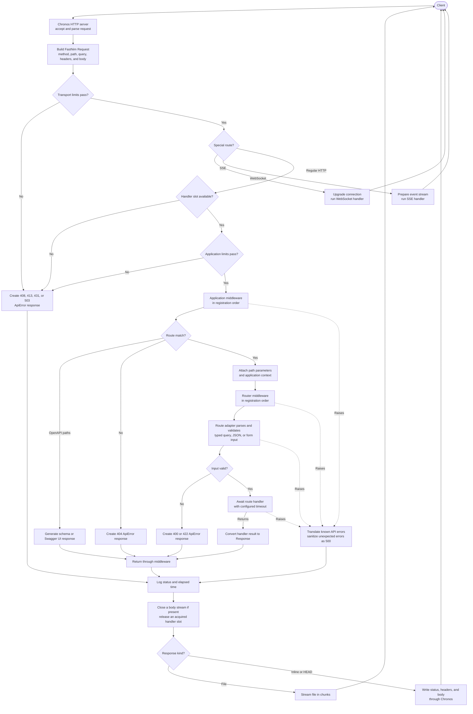

# FastNim

`fastnim` is a small, FastNim API-inspired HTTP framework built on Chronos.

```nim
import chronos
import std/json
import fastnim

let app = initFastNim()

app.get("/items/{itemId}"):
  let itemId = request.pathParam("itemId")
  let page = request.queryParam("page", "1")
  %* {"itemId": itemId, "page": page}

let server = app.serve(port = 8000)
waitFor server.join()
```

Route blocks may end with a status and JSON value tuple. Status aliases such
as `ok`, `created`, and `notFound` are also accepted. Nim requires tuple
syntax, so wrap the pair in parentheses:

```nim
app.get("/items/{itemId}"):
  let itemId = request.pathParam("itemId")
  if itemId == "missing":
    return (notFound, %*{"detail": "item not found"})
  (ok, %*{"itemId": itemId})
```

The current foundation includes route registration for `GET`, `POST`, `PUT`,
`PATCH`, `DELETE`, and `QUERY`, path templates such as `/items/{itemId}`, decoded query
parameters, request bodies and headers, text/JSON/HTML responses, 404 handling, and
the Chronos HTTP server adapter.

## Request-response lifecycle

FastNim keeps network I/O on the Chronos event loop. Chronos accepts and
parses the HTTP/1.1 request, then the server adapter converts it into
FastNim's `Request` type. Regular request bodies are buffered at this point;
multipart bodies remain a one-shot stream for the route's parser.



Application middleware wraps dispatch and therefore sees the response while
the middleware stack unwinds. Router middleware runs only after a route is
matched and wraps that route's handler. A middleware can short-circuit either
stack by returning a `Response` without calling `next`. WebSocket and SSE
routes use their own streaming lifecycles and bypass HTTP middleware and the
ordinary handler timeout.

## Native gRPC

FastNim includes an optional native gRPC listener with unary, server-streaming,
client-streaming, and bidirectional RPCs. It implements HTTP/2 framing, HPACK,
protobuf framing, metadata, and standard gRPC status trailers without a
runtime dependency on nghttp2, OpenSSL, or another system protocol library.
Import and install the plugin, then register a method with the same typed-block
shape as an HTTP route. A complete protobuf service definition is available in
[`examples/hello.proto`](examples/hello.proto):

```nim
import std/options

import chronos
import fastnim
import fastnim/plugins/grpc

type
  HelloRequest = object
    name: string

  HelloReply = object
    message: string

let app = initFastNim()
app.installPlugin(grpcPlugin())

app.grpc(
  "/hello.Greeter/SayHello",
  proto = "examples/hello.proto",
  request = HelloRequest,
  responses = HelloReply,
):
  if request.name.len == 0:
    raise grpcError(GrpcStatus.InvalidArgument, "name is required")
  HelloReply(message: "Hello, " & request.name)

waitFor app.serveGrpc().join()
```

Streaming routes expose a typed `stream` value. The dedicated macros enforce
the request and response cardinality of each RPC shape:

```nim
app.grpcServerStream(
  "/hello.Greeter/SayHelloManyTimes",
  proto = "examples/hello.proto",
  request = HelloRequest,
  responses = HelloReply,
):
  for index in 0 ..< 3:
    await stream.send(HelloReply(message: request.name & " " & $index))

app.grpcClientStream(
  "/hello.Greeter/CollectHello",
  proto = "examples/hello.proto",
  request = HelloRequest,
  responses = HelloReply,
):
  var count = 0
  while (await stream.receive()).isSome:
    inc count
  HelloReply(message: "received " & $count)

app.grpcStream(
  "/hello.Greeter/Chat",
  proto = "examples/hello.proto",
  request = HelloRequest,
  responses = HelloReply,
):
  while true:
    let request = await stream.receive()
    if request.isNone:
      break
    await stream.send(HelloReply(message: "Hello, " & request.get().name))
```

The `proto` path is resolved relative to the Nim source file. FastNim reads it
at compile time and rejects a route when its RPC path, streaming shape, request
object, response object, field order, or field types differ from the protobuf
contract. The built-in codec therefore requires protobuf field numbers to be
sequential from `1` in the same order as the Nim object fields.

Configure direct TLS termination with PEM certificate material. The listener
requires ALPN negotiation of `h2` and permits TLS 1.2:

```nim
let tls = initGrpcTlsConfig(
  readFile("certs/server-cert.pem"),
  readFile("certs/server-key.pem"),
)
app.installPlugin(grpcPlugin(initGrpcOptions(
  address = "0.0.0.0",
  port = 443,
  tls = tls,
)))
```

Fields in the built-in protobuf codec use their Nim declaration order as field
numbers (`1`, `2`, and so on). This works directly with matching `.proto`
messages. For schemas with reserved or non-sequential numbers, overload
`encodeProtobuf` and the typedesc form of `decodeProtobuf` for the message
types. The codec supports scalar values, enums, strings, bytes, nested objects,
and packed or unpacked repeated scalar fields.

The HTTP/2, HPACK, gRPC, and protobuf layers are implemented in Nim. TLS uses
Chronos's BearSSL backend, whose sources are compiled into the application;
it does not dynamically load OpenSSL (`libssl`/`libcrypto`). Omitting `tls`
selects cleartext HTTP/2 (h2c). Message compression is not currently enabled,
so the listener advertises and accepts identity encoding.

RPC shapes, protobuf checking, status trailers, metadata, and listener
configuration are documented in [`docs/grpc.md`](docs/grpc.md). The runnable
service is [`examples/grpc.nim`](examples/grpc.nim).

## Async handlers

Route blocks run asynchronously on the Chronos event loop, so they can await
Chronos futures directly:

```nim
app.get("/inventory"):
  await sleepAsync(10.milliseconds)
  %*{"available": true}
```

Use Chronos-native asynchronous operations such as `sleepAsync` in handlers
and middleware. Do not use `os.sleep`, blocking sockets, or
`std/asyncdispatch`; blocking work stalls every request sharing the event-loop
thread. Existing synchronous handler procedures remain supported through a
registration adapter.

`app.query` supports in-process routing and testing. The installed Chronos HTTP
parser does not recognize the `QUERY` method yet, so serving `QUERY` requests
requires a Chronos version with `MethodQuery` support.

## Request limits

`initRequestLimits` caps body size, header name, value, and count, the raw
header block, how long a client may take to send headers, and how long one
HTTP handler may run:

```nim
let app = initFastNim(
  limits = initRequestLimits(
    maxBodySize = 1024 * 1024,
    maxHeaderCount = 40,
    handlerTimeout = 5.seconds,
  )
)
```

`serve` copies `maxBodySize`, `maxHeadersSize`, and `headersTimeout` into
Chronos. A positive `serve(maxRequestBodySize = ...)` overrides `maxBodySize`
for that server. Header name, value, and count limits, and `handlerTimeout`,
are read on each request. `InfiniteDuration` disables a timeout.
`handlerTimeout` does not apply to server-sent events or WebSocket routes.
Handlers must await Chronos operations; `os.sleep` cannot be cancelled.

| Condition | Status |
| --- | --- |
| Body or upload above its limit | `413` |
| Header name, value, count, or raw header block above its limit | `431` |
| Malformed request | `400` |
| Client stalls while sending headers | `408` |
| HTTP handler exceeds `handlerTimeout` | `503` |

FastNim-owned limit responses use the standard `ApiError` JSON envelope.
`onError` can replace that body.
A handler deadline cancels the handler and is still logged with its status and
elapsed time. The connection stays open for later requests.

## API errors

Framework-generated errors have one public shape:

```json
{
  "code": "validation_failed",
  "message": "validation failed",
  "fields": {
    "body.name": "must not be empty"
  }
}
```

`ApiError` exports `code`, `message`, and `fields`. Field keys are dotted paths
prefixed by their input source (`body`, `form`, or `query`); sequence indexes
are path components. If validation produces multiple failures for one path,
the first message is retained.

Raise a typed application exception when routing should translate a domain
failure automatically:

```nim
proc getProduct(request: Request): Response =
  discard request
  raise newNotFoundError(
    "product was not found",
    code = "product_not_found",
  )

app.get("/products/{id}", getProduct)
```

| Exception | Status | Default code |
| --- | ---: | --- |
| `BadRequestError` | `400` | `bad_request` |
| `UnauthorizedError` | `401` | `unauthorized` |
| `ForbiddenError` | `403` | `forbidden` |
| `NotFoundError` | `404` | `not_found` |
| `ConflictError` | `409` | `conflict` |
| `UnprocessableEntityError` | `422` | `unprocessable_entity` |

Other `CatchableError` values are logged and become a sanitized 500 with code
`internal_server_error`; their messages and stack details are never returned.
An `onError` handler remains an explicit override for framework responses.

## Typed query parameters

Declare query parameters as an object and pass its type to the route. FastNim
parses it before the handler, exposes it as `queryParams`, validates field pragmas,
and documents each field as an OpenAPI query parameter:

```nim
import std/options

type
  SortField = enum
    name = "name"
    price = "price"

  ProductQuery = object
    page {.ge: 1.}: int = 1
    limit {.ge: 1, le: 100.}: int = 20
    available: bool = false
    sort: SortField
    minPrice {.jsonName: "min_price".}: Option[int]
    tags {.jsonName: "tag".}: seq[string]

app.get(
  "/products", queryParams = ProductQuery, responses = @[(200, ProductOut)]
):
  ok ProductOut(
    page: queryParams.page,
    limit: queryParams.limit,
    sort: queryParams.sort,
  )
```

A scalar field without an initializer is required. An initializer supplies its
missing-value default. Missing `Option[T]` and `seq[T]` fields become `none(T)`
and an empty sequence. Use `jsonName` when the query name differs from the Nim
field name. For cross-field rules, pass `validator = validateProductQuery`; it
has the same `ValidationResult` contract as typed request-body validators.

The supported scalar types are `string`, `int`, `bool`, and enums. Booleans
accept `true/false`, `1/0`, `yes/no`, `on/off`, and `y/n` without regard to
ASCII letter case. Enums match their `$` representation exactly and are
case-sensitive, so explicitly named enum strings make a stable wire format.

`Option[T]` returns `none(T)` when absent. `seq[T]` consumes repeated names in
URL order (`?tag=nim&tag=web`); commas are ordinary characters and are not
split. Scalars retain the existing last-value-wins behavior. Missing required
scalars and malformed values return structured 400 errors through
`queryParsingResponse`; successfully parsed values that fail constraints such
as pagination bounds return 422 through `validationResponse`.

The lower-level `queryParam[T](request, name, parsing)` overloads remain
available when a handler needs dynamic parameter names or custom control flow.

## Scaffolding

Install the `fastnim` binary (`nimble install`) and generate a structured API
or server-rendered project:

```sh
fastnim init myapp --template:api
fastnim init website --template:ssr
```

Both templates create `src/settings.nim`, `src/manage.nim`, and separate
`models/`, `routers/`, `services/`, `templates/`, and `migrations/`
directories. The SSR template includes HTMX and the FastNim HTMX plugin.

Database schema changes are always explicit:

```sh
nimble setup
nimble bootstrap
nimble run
```

`nimble setup` is Nimble's built-in dependency-path setup command. The
generated `.nimble` file supplies `bootstrap`, `makemigrations`, and `migrate`.
`bootstrap` generates and applies the initial migration; later schema changes
can use the two individual tasks.
Starting the server never applies migrations automatically.

Omitted choices prompt interactively (framework, package manager, CSS); piped
or CI runs fall back to Svelte, pnpm, and Tailwind. Every choice also has a
flag, so runs stay scriptable:

```sh
fastnim init shop --template:inertiajs --frontend:react --pkgmanager:bun --css:none
```

Add `--auth` to generate a complete starter login flow. The `api` and
`karax_csr` templates use HS256 bearer JWTs; `inertiajs` and `ssr` use
HttpOnly server-side sessions. Every authenticated scaffold includes the
development account `ada` / `s3cret` and notes showing what to replace before
deployment.

```sh
fastnim init shop --template:inertiajs --auth
fastnim init service --template:api --auth
```

Available templates:

- `api` (default) — JSON API with FastORM models and explicit migrations.
  ```sh
  fastnim init myapp
  cd myapp
  nimble setup
  nimble bootstrap
  nimble run
  ```
- `ssr` — server-rendered pages with HTMX forms and fragments.
  ```sh
  fastnim init site --template:ssr
  ```
- `karax_ssr` remains an alias for `ssr`.
- `karax_csr` — Karax client compiled with `nim js`, served statically
  alongside a JSON API.
  ```sh
  fastnim init app --template:karax_csr
  nimble client                      # inside app/
  nim c -r --path:src src/main.nim
  ```
- `inertiajs` — FastNim + Inertia server with a Vite client (Svelte or React,
  Tailwind v4 or plain CSS). The client's `package.json`, Vite/TypeScript
  config, and `node_modules/` live in the project root; sources live in
  `client/src/`. After scaffolding:
  ```sh
  cd shop && nimble dev   # Vite on :5173 + Nim server on :8000, rebuilt on save
  ```
  For production, `nimble build`/`nimble run` bundle the client into
  `client/dist` before compiling the server:
  ```sh
  APP_VERSION=$(date +%s) nimble run
  ```

## Application lifecycle and context

Use load and unload hooks for application-scoped resources such as a database
connection pool. The shared context is available as `ctx` inside route blocks:

```nim
type Database = ref object of RootObj

proc loadDatabase(ctx: Context) =
  ctx.setContext("db", Database())

proc unloadDatabase(ctx: Context) =
  ## Close ctx.db here.
  discard

let app = initFastNim()
app.onLoad(loadDatabase)
app.onUnload(unloadDatabase)

app.get("/health"):
  if ctx.db == nil: "database unavailable" else: "ok"

let server = app.serve()
waitFor server.join()
app.stop(server)
```

`serve` runs load hooks once. `app.stop(server)` stops the server and runs
unload hooks in reverse registration order. `Context.setContext` and
`Context.get` can be used for additional reference-typed dependencies, such
as `ctx.setContext("redis", pool)`.

## Logging

Applications log request completion, status, elapsed microseconds, and
unhandled request errors to a colorized console logger by default. Disable
framework logs with `logs = false`:

```nim
let app = initFastNim(logs = false)
```

## Middleware

Register HTTP middleware with `app.addMiddleware`. Middleware runs in registration order;
each layer receives the request and `next`, and can modify the downstream
response or return early to short-circuit it.

Declare a named middleware with the `middleware` macro; it supplies `request`
and `next` and creates a `Middleware` value. Explicit status responses put the
status first, and JSON status responses require a `JsonNode` (for example,
`%*{...}`):

```nim
middleware requireAuth:
  if request.header("authorization") == "":
    return json(statusUnauthorized, %*{"detail": "missing credentials"})
  await next(request)

app.addMiddleware(requireAuth)
```

Run the complete authorization and response-header example with
`nim c -r --path:src examples/middleware.nim`.

```nim
app.addMiddleware(proc(
    request: Request, next: NextHandler
): Future[Response] {.async: (raises: [CatchableError]).} =
  var response = await next(request)
  response.setHeader("x-request-path", request.path)
  response
)
```

The command style (`app.addMiddleware:`) accepts one middleware. The plural alias
(`app.middlewares:`) accepts a list and registers each middleware in order:

```nim
app.addMiddleware:
  proc(
      request: Request, next: NextHandler
  ): Future[Response] {.async: (raises: [CatchableError]).} =
    var response = await next(request)
    response.setHeader("x-request-path", request.path)
    response

app.middlewares:
  requestId()
  responseTime()
```

FastNim includes dependency-free CORS, request-ID, and response-time middleware:

```nim
app.addMiddleware(cors(initCorsOptions(allowOrigins = @["https://app.example.com"])))
app.addMiddleware(requestId())
app.addMiddleware(responseTime())
```

For a custom destination, adapt any `std/logging.Logger` without changing the
process-wide Nim logging handlers:

```nim
import std/logging

let fileLogger = newFileLogger("api.log", levelThreshold = lvlInfo)
let app = initFastNim(logHandler = nimLogHandler(fileLogger))
```

## Forms

Typed form routes decode ``application/x-www-form-urlencoded`` fields into the
implicit ``form`` value:

```nim
type LoginForm = object
  username: string
  remember: bool

app.post("/login", form = LoginForm, responses = @[(200, LoginForm)]):
  respondOk(form)
```

Fields support strings, booleans, numeric types, and enums. Malformed typed
values return a 400 `ApiError` with code `invalid_request_body`. Run the complete
example with `nim c -r --path:src examples/forms.nim`.

## Multipart uploads

Multipart files stream to server-generated files by default, so file size does
not determine parser memory usage. Parse them from an async handler:

```nim
type ProductImageForm = object
  image* {.upload(
    contentTypes = ["image/jpeg", "image/png"],
    uploadDir = "product-images",
    maxRequestSize = 6.MB,
    maxFileSize = 5.MB,
  ).}: UploadedFile

app.post("/products/{id}/image"):
  let form = await request.parseUpload(ProductImageForm)
  let image = form.image
  json %*{
    "filename": image.filename,
    "contentType": image.contentType,
    "size": image.size,
    "path": image.path,
  }
```

Typed routes can combine ordinary fields and files with
`multipart = Model`. The decoded model is available as `multipart`, receives
the same pragma validation as JSON bodies, and is included in OpenAPI as
`multipart/form-data`. Size limits use binary helpers such as `5.MB` or
`200.KiB` (`1.MB == 1_048_576`):

```nim
type CreateBook = object
  title {.nonEmpty.}: string
  category: CategoryInput
  cover* {.
    upload(
      contentTypes = ["image/jpeg", "image/png"],
      maxRequestSize = 6.MB,
      maxFileSize = 5.MB,
    )
  .}: UploadedFile

app.post("/books", multipart = CreateBook, responses = @[(201, Book)]):
  created saveBook(multipart)
```

Send strings, numbers, booleans, and enums as ordinary form parts. Send nested
objects and collections, such as `category`, as JSON-valued parts. Every field
must occur once except `Option[T]` fields, which may be omitted. File parts use
the field's `upload` limits and MIME allowlist. Parsing or validation failures
remove files already written by the request.

Declare multiple file fields in the same object. A metadata-aware S3 key
builder can route each field to a different prefix:

```nim
type ProductAssetsForm = object
  image* {.upload(contentTypes = ["image/jpeg", "image/png"]).}: UploadedFile
  manual* {.upload(contentTypes = ["application/pdf"]).}: UploadedFile

app.post("/products/{id}/assets"):
  let productId = request.pathParam("id")
  let assets = await s3.upload(
    request,
    ProductAssetsForm,
    key = proc(file: UploadMetadata): string =
      case file.fieldName
      of "image": "products/" & productId & "/images/primary"
      of "manual": "products/" & productId & "/manuals/spec.pdf"
      else: raise newException(ValueError, "unexpected upload field"),
  )
  json %*{
    "image": assets.image.stored.location,
    "manual": assets.manual.stored.location,
  }
```

Single-file S3 schemas return an `UploadedFile` directly. Multi-file schemas
return the populated typed form so each uploaded file remains addressable by
its declared field.

Successful disk uploads belong to the application; move or delete them when
they are no longer needed. Partial files are deleted after malformed input,
limit failures, or cancellation. Client filenames are metadata only and are
never used as filesystem paths. Use the lower-level `parseMultipart` API when
you need multiple files, repeated fields, or a custom validation hook.

In-memory files require explicit opt-in and a mandatory aggregate cap:

```nim
let options = initMultipartOptions(
  storage = UploadStorage.Memory,
  memorySizeCap = 1.MB,
)
```

Malformed multipart input returns JSON `400`, size and file-count violations
return `413`, and rejected content types return `415`. `maxBodySize` is the
outer cap: a `Content-Length` or buffered body above it returns `413` before
`parseMultipart` runs. Keep it at least as large as the endpoint's multipart
`maxRequestSize`. `serve(maxRequestBodySize = ...)` overrides that cap for the
server. A handler timeout cancels parsing and deletes partial uploads. See
[`examples/product_image_upload.nim`](examples/product_image_upload.nim) for a
complete product-image endpoint and `curl -F` command. See
[`examples/mixed_multipart.nim`](examples/mixed_multipart.nim) for metadata and
a file in one typed request.

### External and S3 storage

Storage integrations implement the small `UploadStore`/`UploadSink` contract.
The multipart parser still owns request, file-count, file-size, and content-type
limits, and aborts or rolls back the store when parsing fails or is cancelled:

```nim
let form = await request.parseUpload(ProductImageForm, objectStore)
let imageUrl = form.image.stored.location
```

The optional [`fastnim/plugins/s3`](src/fastnim/plugins/s3.nim) module
implements bounded S3 multipart uploads with Chronos HTTP and built-in SigV4
signing. Configure the destination and credentials once, install the returned
handle, then stream a configured upload directly from the request:

```nim
let s3 = s3Plugin(initS3Config(
  bucket = "product-assets",
  region = getEnv("AWS_REGION", "us-east-1"),
  accessKey = getEnv("AWS_ACCESS_KEY_ID"),
  secretKey = getEnv("AWS_SECRET_ACCESS_KEY"),
  sessionToken = getEnv("AWS_SESSION_TOKEN"), # optional
  endpoint = getEnv("S3_ENDPOINT"),           # optional; e.g. MinIO
))
app.installPlugin(s3)

app.post("/products/{id}/image"):
  let productId = request.pathParam("id")
  let image = await s3.upload(
    request,
    ProductImageForm,
    key = "products/" & productId & "/primary",
  )
  json %*{"location": image.stored.location}
```

See
[`examples/product_image_upload_s3.nim`](examples/product_image_upload_s3.nim)
for a complete product-image endpoint.

## HTML responses

Return HTML pages with the `html` helper, which sets
`text/html; charset=utf-8`:

```nim
app.get("/"):
  html "<h1>Hello from FastNim</h1>"
```

Run [`examples/html.nim`](examples/html.nim) with
`nim c -r --path:src examples/html.nim`.

Template libraries such as [Karax](https://github.com/karaxnim/karax)
render server-side markup to a plain string; stringify the node with `$` and
pass it to `html`. Karax also exports a `text` routine that collides with
FastNim's, so exclude FastNim's from the import when mixing both in one
module (requires `karax` in your own package):

```nim
import fastnim except text
import karax/[karaxdsl, vdom]

app.get("/"):
  let node = buildHtml(tdiv):
    h1:
      text "Hello from FastNim"
  html("<!doctype html>" & $node)
```

Server-side Karax rendering produces static markup only; event handlers do
not survive. For interactive pages, build the Karax app for the browser and
serve the bundle with `serveStatic` instead.

## Static files

Serve a directory at a URL prefix with `serveStatic`, or one file with
`serveSingleFile`. Only `GET` and `HEAD` are handled; misses, traversal
attempts, and dotfiles fall through to normal routing and custom 404
handlers. Responses include a MIME type, `ETag`/`Last-Modified` with `304`
support, single-range `206` responses, and `Cache-Control`. Files above
`streamThreshold` stream in chunks instead of loading into memory:

```nim
let app = initFastNim()
app.serveStatic("/static", directory = "static")
app.serveSingleFile("/favicon.ico", "static/favicon.ico")
```

Bake small assets into the binary with `serveStaticEmbedded` (paths resolve
against the calling file, like `staticRead`) so deployments are a single
file. Files larger than `maxEmbedBytes` (default 1 MiB) or with a media
extension in `denyExts` are rejected at compile time; serve those from disk
with `serveStatic`:

```nim
app.serveStaticEmbedded("/static", "static", maxAge = 86400)
app.serveSingleEmbeddedFile("/robots.txt", "static/robots.txt")
```

Run [`examples/static.nim`](examples/static.nim) with
`nim c -r --path:src examples/static.nim`.

## OpenAPI and Swagger UI

FastNim exposes generated OpenAPI 3.1 JSON at `/openapi.json` and Swagger UI at
`/docs` by default. Typed response and request models produce inline schemas;
path templates produce required path parameters. Configure or disable the
built-in endpoints with the OpenAPI plugin:

```nim
import fastnim/plugins/openapi

let app = initFastNim()
app.installPlugin:
  openApiPlugin(initOpenApiSettings(title = "Items API", version = "1.0.0"))

app.get(
  "/items/{itemId}",
  responses = @[(200, Item)],
  tags = @["items"],
  summary = "Get an item",
  description = "Returns an item by its identifier.",
):
  ok Item(id: 1, name: request.pathParam("itemId"))
```

Change their URLs or turn both endpoints off when installing the plugin:

```nim
let app = initFastNim()
app.installPlugin:
  openApiPlugin(initOpenApiSettings(
    schemaPath = "/internal/openapi.json",
    docsPath = "/internal/docs",
  ))

# Or disable both built-ins:
let privateApp = initFastNim()
privateApp.installPlugin:
  openApiPlugin(initOpenApiSettings(enabled = false))
```

The legacy `openApi` argument to `FastNim` is still supported.

Documentation endpoints go through normal middleware, so protect them with the
same authentication policy as any other route:

```nim
proc restrictDocs(request: Request, next: NextHandler): Response =
  if request.path in ["/docs", "/openapi.json"] and
      request.header("authorization") != "Bearer secret":
    return text("Unauthorized", 401)
  next(request)

app.addMiddleware(restrictDocs)
```

Run [`examples/openapi.nim`](examples/openapi.nim) with
`nim c -r --path:src examples/openapi.nim`.

An untyped route such as `app.get("/health"):` has no model information, so it
is documented only as a generic `200 Successful Response`. Declare
`responses = @[(200, Model)]` (and `body = Model`, `form = Model`, or
`multipart = Model` for typed input) to generate the request and response
schemas automatically. Mixed multipart routes document nested object parts with
`encoding` metadata; see [`examples/mixed_multipart.nim`](examples/mixed_multipart.nim).

## Plugins

FastNim plugins are ordinary Nim packages installed explicitly on an app. A
plugin has a unique name, an install callback, isolated plugin state, ordered
middleware, lifecycle hooks, and optional OpenAPI contributions.

```nim
import fastnim
import fastnim/plugins/ratelimit

let app = initFastNim()
app.installPlugin(rateLimitPlugin(initRateLimitOptions(limit = 100, windowSeconds = 60)))
```

The command style (`app.installPlugin:`) is an equivalent alternative. Each block
takes a single plugin, so repeat it for additional plugins:

```nim
import fastnim/plugins/openapi
import fastnim/plugins/ratelimit

let app = initFastNim()
app.installPlugin:
  openApiPlugin(initOpenApiSettings(
    title = "My Users API",
    version = "2.2.0",
    description = "Internal usermanagement",
  ))
app.installPlugin:
  rateLimitPlugin(initRateLimitOptions(limit = 5, windowSeconds = 60))
```

The plugin is available independently as `fastnim/plugins/ratelimit`; the
`fastnim/plugins` namespace also re-exports its public API.

The built-in reference rate limiter uses in-memory fixed windows keyed by
`x-forwarded-for`, returns `429` with `Retry-After` and `X-RateLimit-*` headers,
and adds `429` to generated OpenAPI operations. Session and rate-limit stores
are async, replaceable interfaces; use a shared Redis/database driver for
limits and sessions across multiple processes. The driver contract, atomic
Redis integration pattern, and session cookie/key-rotation guidance are in
[`docs/stores.md`](docs/stores.md). See
[`examples/ratelimit.nim`](examples/ratelimit.nim).

Third-party packages can define a plugin with `initPlugin(name, version,
installCallback)` and install middleware via `app.addMiddleware`, scoped state through
`app.pluginContext(name)`, and documentation changes through
`app.addOpenApiContributor`.

### Inertia.js

The Inertia plugin turns normal FastNim routes into Inertia page responses. It
serves the initial HTML shell, returns protocol JSON for `X-Inertia` requests,
supports shared and partial props, checks asset versions, and converts `302`
responses after non-GET Inertia requests to `303`.

```nim
import std/json
import fastnim
import fastnim/plugins/inertia

let app = initFastNim()
app.installPlugin:
  inertiaPlugin(initInertiaOptions(
    version = "assets-v1",
    sharedProps = %*{"appName": "FastNim"},
  ))

app.get("/users"):
  inertia("Users/Index", %*{"users": ["Ada", "Linus"]})
```

The default HTML shell loads `/assets/app.js`. Pass a custom `rootTemplate`
to `initInertiaOptions` when using another asset path or additional head tags.
Use `inertiaLocation(url)` when an Inertia request must trigger a full-page
visit. See [`examples/inertia.nim`](examples/inertia.nim) for a runnable server.

## Server-Sent Events

Register an SSE endpoint with `sse`. Its async block sends `ServerSentEvent`
values using `send`; the Chronos adapter writes them with the
`text/event-stream` media type.

Run [`examples/sse.nim`](examples/sse.nim) with
`nim c -r --path:src examples/sse.nim`, then connect a browser `EventSource`
or `curl -N http://127.0.0.1:8000/events`.

[`examples/ticker.nim`](examples/ticker.nim) shows a parameterized ticker
endpoint that sends JSON price-update events.

```nim
app.sse("/events"):
  await send(sseEvent("connected", event = "status", id = "1"))
  await send(sseEvent("ready"))
```

See the [SSE guide](docs/sse.md) for event fields, browser clients, finite
streams, connection limits, and disconnect handling.

## WebSockets

WebSocket routes use the same block syntax as HTTP and SSE routes. The
connection is upgraded by the Chronos adapter before the block starts; call
`accept` to make the connection available, then use `receiveText`, `sendText`,
`receiveBytes`, `sendBytes`, `receiveJson`, or `sendJson`.

```nim
app.websocket("/echo"):
  await websocket.accept()
  while true:
    await websocket.sendText(await websocket.receiveText())
```

Run [`examples/websocket_echo.nim`](examples/websocket_echo.nim) with
`nim c -r --path:src examples/websocket_echo.nim`, then connect to
`ws://127.0.0.1:8009/echo`.

The adapter uses [nim-websock](https://github.com/status-im/nim-websock) and
retains Chronos as the HTTP server.

See the [WebSocket guide](docs/websocket.md) for typed JSON, connection groups,
limits, heartbeats, and authentication guidance.

## MQTT

FastNim includes a Chronos-based MQTT broker plugin with publication routing,
topic captures, subscriptions, and retained messages. See the
[MQTT guide](docs/mqtt.md) for installation, routing, protocol support, and
lifecycle details.

## Typed responses

Declare every status and JSON model a route may return. Within that route,
status helpers such as `ok`, `created`, `accepted`, `badRequest`,
`unauthorized`, `forbidden`, `notFound`, `conflict`, `unprocessableContent`,
`tooManyRequests`, and `internalServerError` are checked at compile time against
the declared status/model pair. The same helpers work in untyped routes and
return JSON responses, including when passed a `%*` JSON node. `noContent void`
is the special empty 204 response.

```nim
type Item = object
  id: int

app.get("/items/{itemId}", responses = @[(200, Item), (404, ApiError)]):
  if request.pathParam("itemId") == "1":
    ok Item(id: 1)
  else:
    notFound initApiError("item_not_found", "item not found")
```

## Typed JSON bodies

For `POST` routes, declare `body = ModelType`; the route receives the decoded
model as `body` and retains the raw HTTP request as `request`. Invalid JSON
returns a 400 `ApiError` with code `invalid_request_body`.

```nim
type
  CreateItem = object
    name: string

app.post("/items", body = CreateItem, responses = @[(201, Item)]):
  created Item(id: 1)
```

For an untyped route, the same helpers accept `%*` values directly:

```nim
app.post("/login"):
  if not authenticated:
    unauthorized %*{"detail": "invalid credentials"}
  else:
    ok %*{"message": "hello"}
```

Rename a model field in request JSON, response JSON, and generated OpenAPI with
the `jsonName` pragma:

```nim
type User = object
  displayName {.jsonName: "display_name".}: string
```

The Nim field remains `user.displayName`, while its JSON property is
`display_name`. Empty names and names that collide with another field are
rejected at compile time.

## Testing

`TestClient` drives your app in-process — no ports, no server — FastAPI
`TestClient` style. The client exposes `get/post/put/patch/delete/query` and
every call returns a `Response` with `status`, `body`, and `headers`; the
`json` helper parses the body:

```nim
import std/unittest
import fastnim
import fastnim/testing

let client = initTestClient(api)

suite "main":
  test "reads root":
    let response = client.get("/")
    check response.status == 200
    check response.json() == %*{"msg": "Hello World"}
```

`fastnim init --template:api` scaffolds a `tests/` suite in exactly this
style. See [`tests/ttestclient.nim`](tests/ttestclient.nim) for per-verb
examples, including headers and query strings.


## Agent skill

FastNim ships a portable [Agent Skill](https://github.com/agentskills/agentskills)
that teaches coding agents the framework's rules: Chronos-only async, route
macros, path/query/body extraction and validation, middleware and dependency
injection, OpenAPI metadata, plugins, streaming, and testing.

Install it into a project with the `/fastnim-install` command (Kilo) or
directly:

```sh
bash .kilo/skills/fastnim/scripts/install.sh /path/to/project
```

The installer copies the skill to `.agents/skills/fastnim/` and creates an
`AGENTS.md` in the project root that points at it. A project that already has a
`.agents` folder is left untouched.


## API documentation

Every exported symbol is documented with `##` doc comments. Render the full
HTML API reference with `nim doc`:

```sh
nimble docs
```

This generates one page per module under `htmldocs/` (open
`htmldocs/fastnim.html` to start). To render a single module while editing
its docs:

```sh
nim doc --outdir:htmldocs --path:src src/fastnim/routing/router.nim
```
